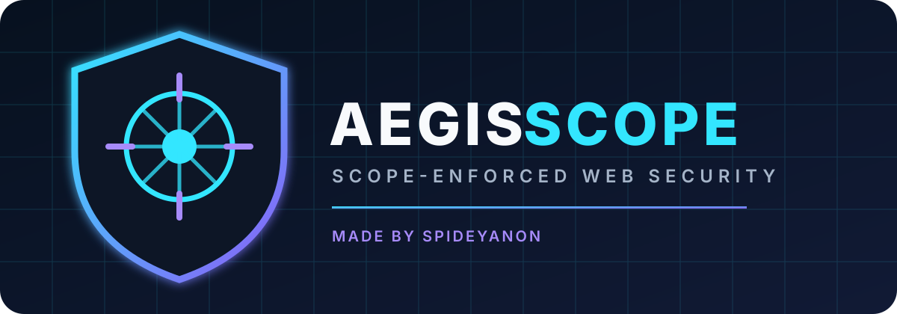

# AegisScope



**Made by SpideyAnon**

AegisScope is a Linux-only, scope-enforced web security assessment CLI for websites you own or have explicit permission to test. Arch Linux is the primary supported platform. It inventories DNS, TLS, certificate subdomains, linked hosts, and technology evidence; crawls authorized pages; performs passive security checks; optionally runs non-destructive GET-parameter canaries; and generates evidence-focused reports.

> Use AegisScope only under current written authorization. A successful scan does not prove an application is secure, and every finding requires human verification.

## Current capabilities

- Exact-host and optional subdomain allowlists
- HTTP/HTTPS scheme restrictions
- Redirect scope enforcement
- Request-rate, page, response-size, and total-request limits
- Same-scope HTML crawling without form submission
- DNS addresses and TLS certificate inventory
- Passive subdomain discovery from certificate names and page links
- Server, framework, version, and low-confidence OS evidence
- Security header, cookie, mixed-content, and password-form checks
- Optional input-reflection, SQL-error, and open-redirect indicators
- Query-value redaction in reports and audit logs
- JSON and Markdown reports plus a JSONL request audit trail
- Verification labels separating confirmed, likely, review-required, and informational results
- Environment-variable expansion for authentication headers

AegisScope does not perform denial of service, password attacks, data extraction, persistence, malware delivery, file writes, or automatic exploitation.

## Install

Linux and Python 3.11 or newer are required. Windows and macOS are intentionally unsupported.

On Arch Linux and Arch-based distributions:

```bash
sudo pacman -S --needed python python-pipx git
pipx ensurepath
pipx install git+https://github.com/spideyanik/aegisscope.git
```

Start a URL-first assessment:

```bash
aegisscope owner-setup
aegisscope assess https://staging.example.com
```

The owner setup command stores only a salted PBKDF2 hash in `~/.config/aegisscope/owner-policy.json` with `0600` permissions. Every passive or active assessment requires the matching owner-issued code before any network request. Choose a profile after entering the URL; AegisScope then performs reconnaissance and the selected assessment without requiring a configuration file.

The local access-code gate controls ordinary use of the installed CLI. It does not replace written permission from the website owner, and it cannot prevent someone with source-code or administrator access from modifying their own copy.

Every command launch displays the AegisScope terminal shield and project attribution. Package installation intentionally avoids post-install scripts; the logo appears when the installed command is started.

For local development:

```bash
git clone https://github.com/spideyanik/aegisscope.git
cd aegisscope
python -m venv .venv
. .venv/bin/activate
python -m pip install -e .
```

For a globally available command in an isolated environment:

```bash
pipx install .
```

## Configure

The easiest first run is the guided menu:

```bash
aegisscope
```

You will define or load an authorized target and choose one of these profiles:

- Passive audit: safe crawling, headers, cookies, and mixed-content checks
- Injection indicators: passive checks plus harmless reflection and database-error canaries
- Redirect validation: passive checks plus a reserved-domain open-redirect canary
- Full safe assessment: every currently implemented non-destructive check

You can also start the menu explicitly and choose other file locations:

```bash
aegisscope guided --config aegisscope.json --output-dir reports
```

Active profiles require the exact interactive authorization confirmation. They never submit forms, follow an external redirect, extract database data, or attempt code execution.

## Reconnaissance accuracy

AegisScope reports observed IP addresses, TLS protocol and certificate metadata, certificate subdomains, linked subdomains, HTTP technology headers, HTML framework markers, and exposed versions. It does not scan a discovered host unless the scope configuration permits it.

An HTTP banner cannot reliably identify the server operating system, patch level, or exploitable CVEs. OS values are therefore labeled as low-confidence hints. Exposed software versions are evidence for manual advisory review, not proof of vulnerability.

## Finding verification

- `confirmed`: the exact configuration weakness or behavior was directly reproduced, such as an open redirect or exposed Git metadata
- `likely`: strong evidence exists, but exploitability still depends on application context
- `needs-review`: a safe canary found an indicator such as reflected input, not a proven exploit
- `informational`: inventory or diagnostic evidence with no vulnerability claim

AegisScope does not claim to find every vulnerability. Authentication flaws, IDOR, business-logic abuse, stored XSS, and many authorization issues require controlled test accounts and human analysis.

## Non-interactive use

Create a passive configuration:

```bash
aegisscope init https://staging.example.com \
  --owner "Example Company" \
  --authorization-reference "SEC-2026-001"
```

Review `aegisscope.json` carefully. Authentication values should come from environment variables rather than being committed:

```json
"headers": {
  "Authorization": "${AEGISSCOPE_AUTHORIZATION}"
}
```

Validate and run:

```bash
aegisscope validate --config aegisscope.json
aegisscope scan --config aegisscope.json --output-dir reports
```

The output directory contains `report.json`, `report.md`, and `audit.jsonl`.

## Active profiles

Active mode mutates only existing GET query parameters. It uses an alphanumeric reflection marker, one trailing single quote to identify newly exposed database errors, and `example.invalid` to identify unvalidated redirects. It does not submit forms or follow the external redirect.

Enable them only after reviewing the target and testing on staging:

1. Set `"active_probes": true` in `aegisscope.json`.
2. Run with both required command-line gates:

```bash
aegisscope scan --config aegisscope.json --output-dir reports \
  --profile injection --confirm-authorization
```

Available profile names are `passive`, `injection`, `redirect`, and `full-safe`.

## Safe testing

Run the unit tests before changing scanner behavior:

```bash
python -m unittest discover -s tests -v
```

Use intentionally vulnerable local applications such as OWASP Juice Shop or WebGoat for development. Start against staging with low request limits. Do not point development builds at third-party systems.

## Roadmap

- Authenticated browser crawling with Playwright
- OpenAPI import and API inventory
- Two-account authorization/IDOR comparison workflow
- TLS certificate analysis
- Plugin SDK with mandatory scope-gated HTTP transport
- HTML dashboard and finding review workflow
- SARIF output for CI systems

## License

Proprietary. Copyright 2026 SpideyAnon. Access and use require prior written authorization. See `LICENSE`.
